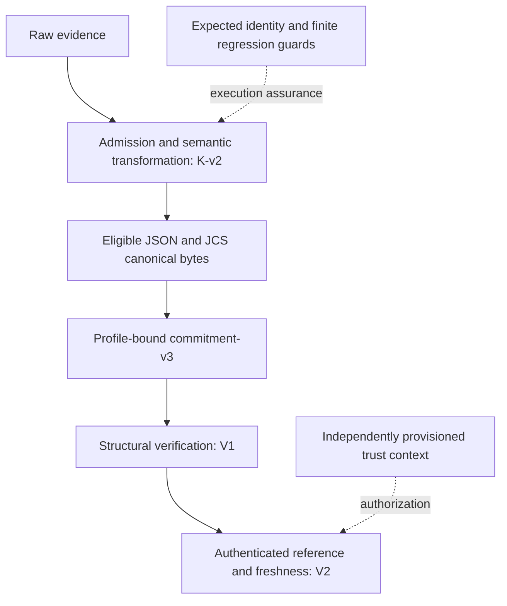

> **PUBLICATION LICENSING:** No blanket license is granted for the authors' original materials. Third-party components retain their own terms. See `LICENSING.md`.

> **P03 PUBLIC DERIVATIVE:** The original P03 archive is preserved privately; the public release contains a privacy-filtered derivative that removes generated bytecode caches only (retained evidence unchanged). Verify with `python verify_v19_public_release.py experiments/v19`.

# Beyond Canonical JSON

## Semantic Interoperability Assurance for Tamper-Evident Commitment Pipelines

**Research artifact companion to `v19.tex` · BCJ-V19 · Evidence freeze: 25 November 2026**

**Author:** Minh Tuan Le, Faculty of Electrical and Electronics Engineering, Hanoi Open University, Hanoi, Vietnam. Correspondence: `lmtuan@hou.edu.vn`.

**Funding:** Hanoi Open University, Project MHN2026-CT01-03.

**Publication status:** Manuscript prepared for IEEE Access; no acceptance, publication DOI, artifact badge, or independent replication is asserted.

**Scientific status:** Frozen evidence accepted within the research project's review process. Engineering QA remains partially completed with documented limitations. No consolidated Docker clean-room execution was performed.

## Contents

- [1. Research overview](#1-research-overview)
- [2. Artifact scope and repository organization](#2-artifact-scope-and-repository-organization)
- [3. Quick start: verify the frozen evidence](#3-quick-start-verify-the-frozen-evidence)
- [4. Frozen identities and integrity](#4-frozen-identities-and-integrity)
- [5. Evaluation design and expected results](#5-evaluation-design-and-expected-results)
- [6. Claim-to-evidence navigation](#6-claim-to-evidence-navigation)
- [7. Re-executing the experimental code](#7-re-executing-the-experimental-code)
- [8. Metric definitions and statistical interpretation](#8-metric-definitions-and-statistical-interpretation)
- [9. Correction history and negative findings](#9-correction-history-and-negative-findings)
- [10. Reproducibility and security boundaries](#10-reproducibility-and-security-boundaries)
- [11. Research integrity, data and AI disclosure](#11-research-integrity-data-and-ai-disclosure)
- [12. Reporting discrepancies and extending the research](#12-reporting-discrepancies-and-extending-the-research)
- [13. Citation, licensing and contact](#13-citation-licensing-and-contact)
- [14. Release acceptance checklist](#14-release-acceptance-checklist)

## 1. Research overview

Deterministic serialization, including the JSON Canonicalization Scheme (JCS, RFC 8785), provides a reproducible encoding of a JSON value. It does not establish agreement on the business interpretation of differently represented records. Nor does it establish correct execution of an intended commitment construction or authorization of a supplied commitment root.

This study separates business equivalence, canonical-input equivalence, and full commitment-input equivalence. It specifies five contract-relative correctness obligations: admission coverage, exclusion of nonadmissible inputs, equivalence completeness, distinction preservation, and cross-implementation agreement. A normative payment contract (K-v2) defines exact decimal and temporal transformations, field-scoped Unicode normalization, admission diagnostics and required batch membership. Commitment-v3 binds full-length semantic-profile and construction digests.

The evaluation investigates complementary assurance layers rather than proposing a new canonicalization, hash, or signature primitive:



The figure is a conceptual dependency diagram, not a timing trace or an assertion that every guard executes at the depicted stage.

### Research questions

The three research questions in `v19.tex` are preserved:

1. **RQ1:** What do deterministic-byte conformance and explicit construction identity establish, and what do they leave unresolved?
2. **RQ2:** Can a complete payment contract support admission-aware semantic agreement and distinction preservation in separately coded implementations, and which defects emerge during evaluation?
3. **RQ3:** Can the implementations reconstruct identical commitments and localize observable divergence by pipeline stage, and what incremental assurance do profile-aware execution and authenticated reference verification provide?

P07 provides cross-cutting evidence reconciliation and reproducibility support; it is not an additional research question.

## 2. Artifact scope and repository organization

This README is written for an archive-first research release. The following is the recommended publication layout. It is not a claim that a public GitHub repository has already been populated or that every dependency has been deposited. Before publication, the maintainer must assemble the listed files, preserve their bytes and complete the release checks in Section 14.

```text
repository/
├── README.md
├── v19.tex
├── verify_v19_evidence.py
└── experiments/
    └── v19/
        ├── BCJ_V19_FINAL_SCIENTIFIC_SSOT.json
        ├── BCJ_V19_FINAL_CLAIM_RESTRICTIONS.md
        ├── BCJ_V19_FINAL_AUTHOR_HANDOVER.md
        ├── BCJ_V19_EXPERIMENT_LEAD_MASTER_SSOT.md
        ├── P07_EXPERIMENT_LEAD_FINAL_DISPOSITION.md
        ├── BCJ_V19_P01_CLOSURE_REVIEW.zip
        ├── BCJ_V19_P02_R4A_REVIEW.zip
        ├── BCJ_V19_P03_FINAL_QA_CLOSED_REVIEW.zip
        ├── BCJ_V19_P04_FINAL_MEASURED_REVIEW.zip
        ├── BCJ_V19_P05_FINAL_MEASURED_REVIEW.zip
        ├── BCJ_V19_P05_CORRECTIVE_R2B_FINAL_REVIEW.zip
        ├── BCJ_V19_P07_FINAL_CONSOLIDATED_REVIEW.zip
        ├── BCJ_V19_P07_R1_FINAL_CORRECTIVE_REVIEW.zip
        └── corresponding detached .zip.sha256 files
```

Intermediate archives should also be retained in a clearly labelled history directory or release asset collection. Their inventory is given in the Master SSOT. They document methodological revisions, not additional independent samples. The eight principal ZIPs above suffice for the supplementary archival checker in Section 3; they do not by themselves constitute a complete executable dependency closure for every phase.

### Authority of the records

| Record | Purpose |
|---|---|
| `BCJ_V19_FINAL_SCIENTIFIC_SSOT.json` | Authoritative frozen headline numbers |
| `BCJ_V19_FINAL_CLAIM_RESTRICTIONS.md` | Mandatory scope and wording restrictions |
| `P07_EXPERIMENT_LEAD_FINAL_DISPOSITION.md` | Scientific closure and residual engineering qualifications |
| `BCJ_V19_EXPERIMENT_LEAD_MASTER_SSOT.md` | Detailed design, chronology, secondary evidence, artifact inventory and traceability |
| Original phase archives | Frozen inputs, source, observations, diagnostic outputs and execution records |
| `BCJ_V19_FINAL_AUTHOR_HANDOVER.md` | Manuscript integration rules |
| `v19.tex` | Scientific manuscript; must remain consistent with the evidence |

If a discrepancy is found, report it with the original source identities and affected claim. A summary table must never silently override raw evidence. The final SSOT is an approved interpretation, not a prohibition against discovering or publishing a genuine error.

## 3. Quick start: verify the frozen evidence

### 3.1 Prerequisites

- Python 3.12.9 is the original Python runtime. The supplementary archival checker uses only standard-library modules and does not require the semantic engines, third-party packages, Docker, a blockchain node, credentials, or network access.
- Obtain the eight exact archives in Section 4. Keep their filenames and byte contents unchanged.
- Run from the repository root with the layout in Section 2, or pass the directory actually containing the archives.

```bash
python --version
python verify_v19_evidence.py experiments/v19
```

The script opens ZIPs directly without extracting or modifying the archived source and data. It verifies the expected archive SHA-256 values, unique ZIP member names and CRC integrity. It then reaggregates selected original raw evidence using separate standard-library code. It exits nonzero on a failed check rather than coercing a discrepancy into the expected result.

This checker was added as a **post-freeze reviewer convenience utility**. It was executed successfully against the eight supplied frozen archives while preparing this README. It is not part of the original measured pipeline, is not an independent third-party implementation, and does not modify the original scientific SSOT. Its expected values are assertions checked after computation, not inputs to outcome classification.

### 3.2 Expected archival-check output

The output is JSON with the following principal fields (abridged):

```json
{
  "scope": "archival checks only; no new execution, no third-party replication",
  "archive_sha256_and_crc": 8,
  "P03": {
    "admission_reason": "630/630 per implementation vs archived oracle",
    "canonical_and_leaf": "600/600",
    "EQ": 150,
    "NEQ": 150,
    "batch_outcomes": 18,
    "leaves_per_implementation": 131,
    "nodes_per_implementation": 114
  },
  "P04": {
    "correct": {"A1": 45, "A1+PID": 75, "A1+CI": 55, "A2": 85},
    "unsafe_release": {"A1": 55, "A1+PID": 25, "A1+CI": 45, "A2": 15},
    "paired_A1_A2": [45, 0, 40, 15]
  },
  "P05": {
    "first_pass_and_corrective": [15, 40],
    "paired": [15, 0, 25, 0],
    "matched_differences": 0,
    "applicable_states": 39,
    "missing_state_control": 1
  },
  "P06": {
    "recorded_digest_matches_eq6": 30,
    "recorded_digest_matches_campaign": 0,
    "formula_reexecution": false,
    "onchain_verification": false
  }
}
```

P04 also reports the correct benign counts, 40 per arm. The two paired arrays are ordered as both correct, baseline only, augmented configuration only, neither correct.

**What this check does and does not establish:** P03 compares E1 outputs to the archived expected records, checks both legs of labelled pairs, recomputes E1 leaf preimages, and reconstructs E4 roots from recorded leaf digests while checking recorded node preimages. It does not rerun the semantic parsers, reconstruct E4 leaves from original raw records, or independently adjudicate business truth. P04 reclassifies releases using the frozen corpus and canonical-digest expectations. P05 checks actual decisions against authorized labels, arm-specific decision expectations, matched first-pass/corrective values and expected state values from the archived re-audit; it does not independently validate signatures or regenerate the state oracle. P06 compares recorded root values, not the historical formula implementations. P01, P02 and P07 archives are verified for byte identity and ZIP integrity in this utility; their entire scientific procedure is not re-executed. The utility does not verify every internal checksum manifest, reproduce all secondary metrics, establish exhaustive robustness, or replace phase-specific scripts.

If a result differs, retain the entire output and traceback. Do not edit the archives or change an expected result simply to make the check pass.

## 4. Frozen identities and integrity

### 4.1 Principal evidence archives

The archive name is `BCJ_V19_` + the suffix below + `.zip`. All eight hashes were recomputed from the supplied files during preparation of this README and matched the frozen register.

| Archive suffix | SHA-256 |
|---|---|
| `P01_CLOSURE_REVIEW` | `b8e3d23bd61dd6e7bc6e22d9ac91c4ac7b155b9dd7b935310ac421d117f468b7` |
| `P02_R4A_REVIEW` | `3513e3c926a29c6e6cc3d0dcd461b27cdee47c45cfa5e4c0bb92ef4b59a4aca3` |
| `P03_FINAL_QA_CLOSED_REVIEW` | `45053224dc25c314a0e305324ccb087020f3832b4fa00b569833aad18c122761` |
| `P04_FINAL_MEASURED_REVIEW` | `2900ffb2bca0ac91ad33d6661bcbd457976f19256b1266ca7a9e6e3f457e204b` |
| `P05_FINAL_MEASURED_REVIEW` | `719db8c483a40a437f7e7cfeb7797bfd1fdcd9ca1fb2bd28cd24cb4dd18a4834` |
| `P05_CORRECTIVE_R2B_FINAL_REVIEW` | `9abff431c6ec5d1887596ebf86de2d9ad694f536cb2842b3018b785e597f576f` |
| `P07_FINAL_CONSOLIDATED_REVIEW` | `ec0e5448be666ace8ac63aa12102e18da53603230b78993077d3c2d7a1beed09` |
| `P07_R1_FINAL_CORRECTIVE_REVIEW` | `b53daa567527fe2b7828a38dfb8a1732fc48081b9c6c8526a63641d2382b9d03` |

The frozen manuscript source `v19.tex` accompanying this README had SHA-256 `787da0c3900a16325cea013a39d60a0f524ea5e5dfa2faecbbe1661ebe7cebbd` when inspected. If an editorial revision changes the manuscript, publish its new source hash and explain the revision; the scientific archive hashes remain unchanged.

### 4.2 Semantic and construction identities

| Identity | Value |
|---|---|
| K-v2 semantic-profile digest | `caa2f3e561edbac1f73ec2926bea8009cce176ba8b8c7f900ebc7e8de454b429` |
| Commitment-v3 construction digest | `d1e46eb5c6e0688b03c085ce5ed83ba134fffc6638a5fc0df8ed143b12aaf91d` |
| Final Python source SHA-256 | `2b6924010d528f39c05ac1f5d332ecee814e2d6a09fa3e38425daa97d119355f` |
| Final Go source SHA-256 | `493102b2265996b734f2d67931ed07547d69026af09d0ea0dbe9f1a98467a5fa` |
| P03 final QA handover commit | `deac7e74b643adac229e877a5a20c723909b9ba0` |
| P04 measured commit | `d293c4423a6f81debda6ee84d4b46f6df0b6278d` |
| P05 first-pass commit | `9e9f952acaf3bf196306dc81b877d5583a25a185` |
| P05 corrective commit | `8ad0afa5b124eee9fbcfa1a3e021fd6011b68030` |
| P07-R1 corrective commit | `fb67aefb74632e92b43318f74ad2f9be0bf199ba` |
| Final administrative commit | `dc3634179bd3028ab78ff06a991f5851101bb4f1` |

Source-byte digests refer to the frozen representations recorded in the evidence; line-ending conversions may change byte hashes without changing source semantics. Keep ZIPs unchanged, and avoid automatic line-ending conversion when copying exact source members. The Git identities are reported historical repository identities, not newly verified reachable commits in a public repository. A checksum proves equality with an expected byte sequence; it does not certify authorship, authenticity of an external source, correctness, or completeness of the scientific method.

### 4.3 Manual integrity checks

On systems with GNU coreutils, from the archive directory:

```bash
sha256sum BCJ_V19_P03_FINAL_QA_CLOSED_REVIEW.zip
```

On PowerShell:

```powershell
Get-FileHash BCJ_V19_P03_FINAL_QA_CLOSED_REVIEW.zip -Algorithm SHA256
```

Compare to the exact table value. Detached checksum files are supplied with the original archives. Check each phase-specific internal manifest using its documented path base; some are relative to a phase directory and others to the package root. Do not assume all manifests have an identical layout. A regenerated checksum must not be treated as an independent trust anchor after modification.

## 5. Evaluation design and expected results

### 5.1 P00–P02: evidence provenance and normative semantics

P00 establishes the manuscript and evidence identity. P01 replays the reconstructed historical J01 corpus using legacy simulator-level machinery: 150 equivalent pairs, 150 distinct pairs and 30 underspecified singletons (330 units, 630 record occurrences). There are 600 admissible occurrences, 30 underspecified occurrences and no malformed/prohibited inputs in this particular corpus. P01 observes 600/600 admissible coverage, 150/150 equivalent and distinct pair outcomes, and 30/30 abstentions. Malformed/prohibited rejection is N/A for J01. P01 was executed before formal phase approval and retrospectively accepted.

P02 specifies K-v2 and its exact admission semantics. It preserves numeric lexemes, quantizes supported nonnegative monetary amounts to minor units, uses integer epoch-millisecond timestamps, applies Unicode 15.0 NFC only to the designated beneficiary field, preserves opaque identifiers, and defines field-specific alias and absence rules. Malformed inputs take precedence over prohibited and underspecified conditions. The final contract and normative manifest, not this summary, determine the supported lexical forms and limits.

The corrected oracle passes 21/21 targeted corrective fixtures and 71/71 inherited adversarial regression fixtures, and agrees with all 630 reconstructed J01 occurrences. These are same-team regression checks, not external business adjudication.

For admitted canonical bytes `F(d)`, the v3 construction is:

```text
leaf = SHA256(0x00 || 0x03 || semantic_profile_digest[32]
             || construction_digest[32] || F(d))
node = SHA256(0x01 || left[32] || right[32])
empty_root = SHA256(0x02 || 0x00)
```

A singleton root is its leaf. Larger trees recursively split at the largest power of two strictly below the number of leaves. Order and duplicate occurrences are retained. Required membership is multiset inclusion, not simple set membership or proof of externally complete inventory. Historical v2 used a four-byte construction label and is not interchangeable with v3.

### 5.2 P03: cross-language interoperability

Both separately coded implementations were evaluated on the same reconstructed J01 records under the frozen K-v2 contract. The evaluator owns expected records; procedural separation does not imply independent authorship, third-party replication, or OS-enforced blinding.

| Outcome | Frozen result |
|---|---:|
| Admission and reason agreement | 630/630 |
| Typed business objects | 600/600 |
| Eligible JSON representations | 600/600 |
| Exact canonical bytes and commitment leaves | 600/600 |
| Equivalent pairs, both accepted and equal | 150/150 per implementation |
| Distinct pairs, both accepted and unequal | 150/150 per implementation |
| Underspecified abstentions | 30/30 |
| Final boundary regression | 31/31 per implementation |
| Final adversarial regression | 71/71 per implementation |
| Final corrective regression | 21/21 per implementation |
| Batch-root outcomes | 18/18 descriptors |
| Recorded E4 leaves | 131 per implementation |
| Recorded E4 internal-node digest checks | 114/114 per implementation |
| Original first-stage attribution | 9/11 |
| Separate corrective attribution controls | 2/2 |

The final agreement follows targeted correction of observed alias, scale, Unicode and multiplicity defects. The first-pass discrepancies remain part of the evidence. Do not reinterpret post-exposure corrections as an unseen test or combine attribution denominators into 11/11 original success.

### 5.3 P04: matched execution assurance

The evaluator constructs 100 units (60 adverse, 40 benign), equally distributed across four groups: semantic-profile mismatch, construction mismatch, semantic transformation regression, and hidden encoding/batch regression. The same typed engine, JCS and v3 construction are used across four measured arms. Each unit is evaluated under every arm, giving 400 observations.

| Arm | Additional control | Correct /100 | Unsafe release /60 | Correct benign /40 |
|---|---|---:|---:|---:|
| A1 | None (strong typed baseline) | 45 | 55 | 40 |
| A1+PID | Expected profile/construction identity | 75 | 25 | 40 |
| A1+CI | Finite regression checks | 55 | 45 | 40 |
| A2 | Both controls | 85 | 15 | 40 |

Primary paired comparison A1 versus A2: both correct 45; A1-only 0; A2-only 40; neither 15. The descriptive improvement is 40 percentage points. The reduction in unsafe releases is 40 of the 55 baseline unsafe releases (72.7% relative). All 40 benign units are preserved by each arm. The 15 remaining shared misses are a substantive negative finding; the guards are not comprehensive.

The performance campaign contains 36 warm-ups and 120 measured observations across four arms and batch sizes 100, 1,000 and 5,000. The original timing CSV uses `duration_ns`; allocated memory is Python-traced peak allocation, not process RSS. Performance covers combined processing and guard checks, not isolated component overhead or complete deployment lifecycle. The P07-R1 code did not independently rederive medians and IQRs. Report the original performance table with its scope or compute a new summary explicitly labelled as a supplementary analysis. Do not force new timings to equal historical measurements.

### 5.4 P05: authenticated trusted-reference verification

V1 and V2 share structural verification. V2 additionally verifies an Ed25519-signed checkpoint against independently provisioned authorization context and sequence-based state. The signature domain is `BCJ-V19-P05-CHECKPOINT` followed by bytes `00 01`, then the JCS checkpoint encoding. The checkpoint binds the publisher, checkpoint ID, semantic-profile digest, construction digest, batch ID, root, tree size and sequence. Embedded evidence identifiers are not themselves trusted authorization data.

The final corpus contains 11 authorized and 29 adverse units, including one authorized exact replay. Each unit is evaluated under two arms (80 first-pass observations).

| Outcome | V1 | V2 |
|---|---:|---:|
| Common authorization-objective correctness | 15/40 | 40/40 |
| Authorized acceptance | 11/11 | 11/11 |
| Structurally invalid rejection | 4/4 | 4/4 |
| Structurally valid unauthorized acceptance | 25/25 | 0/25 |
| Coordinated substitution acceptance | 6/6 | 0/6 |

V1 satisfies its own structural contract on 40/40 units. Its lack of authorization is not a structural verifier defect. The paired comparison is 15/0/25/0, a descriptive improvement of 62.5 percentage points under the common objective.

A separately coded same-team checker agrees with the historical oracle on 40/40 decision outcomes. It shares the semantic adapter and standard cryptographic libraries; exact independent reason-category reconstruction is not claimed. The exact state re-audit covers 39 applicable final states and one correctly rejected missing-state control (N/A). All 40 initial states agree with their expected values. Rejection does not advance trusted state; exact authorized replay is permitted by the defined sequence policy.

The corrective R2B run repeats the same 40 units and produces 80 additional observations. It reproduces the main outcomes with zero recorded decision, reason, initial-state or final-state differences across matched keys. These observations are not 80 new independent samples.

### 5.5 P06: historical construction divergence

The recovered CR-0006 artifact contains 30 historical batch roots. Two candidate constructions differ in whether the preceding root is a Merkle input or part of an explicitly framed external hash:

```text
artifact: r[j] = MerkleRoot([r[j-1]] + B[j])
campaign: r[j] = SHA256(0x02 || uint64_be(j) || r[j-1] || MerkleRoot(B[j]))
```

The historical Merkle construction duplicates an odd leaf and must not be confused with v3's recursive split. Exact serialization and workload generation are defined by the recovered historical source. The fresh historical reconstruction recorded 30/30 matching roots for the artifact formula and 0/30 for the campaign formula, first diverging at batch zero. The deterministic workload was regenerated from seed 42. Transaction and block fields in the delivered CSV are empty. This is reproduction of a known historical discrepancy, not evidence of a hash collision, JCS failure, newly observed production incident or independent blockchain transaction verification.

### 5.6 P07: consolidated evidence review

An initial consolidation used semantic-admission agreement instead of P04 safe-release correctness and selected the wrong paired comparison. P07-R1 corrected this mismatch. The research project's final review reaggregated original P03/P04/P05 evidence; fresh-directory P05 execution and fresh-process aggregation were demonstrated. Full engineering QA and consolidated Docker reproduction remain incomplete. The final administrative closure preserves these qualifications.

## 6. Claim-to-evidence navigation

The following paths are exact member paths or unique path suffixes within the named ZIPs. P04 and P05 archives contain a top-level directory matching their archive name; omit that prefix only when using the suffix-aware checker. P03 archives use paths directly under `results/`, `implementations/` and `scripts/`.

| Claim or procedure | Archive phase | Member paths / entry points |
|---|---|---|
| Legacy admission and process deviation | P01 closure | `results/P01/raw/J01_PER_LEG_RESULTS.jsonl`; `results/P01/PROCESS_DEVIATION_REPORT.md` |
| Effective contract and construction | P03 final QA (contains P02 records) | `results/P02/NORMATIVE_CONTRACT.R4.md`; `results/P02/K_V2_FREEZE_ATTESTATION.json`; `results/P02/COMMITMENT_V3_SPEC.R4.md` |
| P02 oracle repair | P02 R4A | `results/P02/R4A_ORACLE_REPAIR_REPORT.md`; `scripts/r4a_oracle.py`; `scripts/r4a_j01_compare.py` |
| P03 E1 inputs and expected outputs | P03 final QA | `results/P02/J01_INDEPENDENT_EXPECTED.R4A.jsonl`; `implementations/python-dev/_e1_records.jsonl` |
| P03 E1 raw observations | P03 final QA | `results/P03/repro_e1/e1_py.jsonl`; `results/P03/repro_e1/e1_go.jsonl` |
| P03 first-pass and corrected regressions | P03 final QA | `results/P03/R3_REGRESSION_REPORT.md`; `results/P03/E2_E3_REPORT.md`; corresponding E2/E3 raw JSONL files |
| P03 E4 | P03 final QA | `results/P03/P03_E4_BATCH_DESCRIPTORS.jsonl`; `results/P03/P03_E4_EXPECTED_ROOTS.jsonl`; `results/P03/P03_E4_PYTHON_RESULTS.jsonl`; `results/P03/P03_E4_GO_RESULTS.jsonl` |
| P03 sentinel and attribution | P03 final QA | `results/P03/SENTINEL_CORRECTION_REPORT.md`; `results/P03/STAGE_ATTRIBUTION_REPORT.md`; `results/P03/P03_STAGE_ATTRIBUTION_RESULTS.jsonl`; `results/P03/P03_STAGE_ATTRIBUTION_TRACES.R3C.jsonl` |
| P04 final execution inputs | P04 measured | `p04_evaluator/P04_MEASURED_CORPUS.R4A.jsonl`; `p04_evaluator/P04_EVALUATOR_ORACLE.R4A.jsonl`; `p04_evaluator/P04_FINAL_EXECUTION_LOCK.json` |
| P04 labels and raw classification | P04 measured | `p04_evaluator/P04_MEASURED_CORPUS.jsonl`; `p04_evaluator/P04_EVALUATOR_ORACLE.jsonl`; `results/P04/P04_MEASURED_RAW.jsonl` |
| P04 timing | P04 measured | `results/P04/P04_PERFORMANCE_RAW.csv`; `results/P04/P04_PERFORMANCE_SUMMARY.csv`; `results/P04/P04_PERFORMANCE_META.json` |
| P05 first pass | P05 measured | `p05_evaluator/P05_MEASURED_CORPUS.jsonl`; `p05_evaluator/P05_EVALUATOR_ORACLE.jsonl`; `p05_evaluator/P05_RAW_OBSERVATIONS.jsonl` |
| P05 separately coded checker | P05 corrective | `p05_r2b/p05_independent_oracle.py`; `p05_r2b/P05_R2B_INDEPENDENT_ORACLE_V2.jsonl` |
| P05 state and corrective observations | P05 corrective | `p05_r2b/P05_FIRST_PASS_STATE_REAUDIT.jsonl`; `p05_r2b/P05_R2B_RAW_OBSERVATIONS.jsonl`; `p05_r2b/P05_FIRST_PASS_VS_R2B_COMPARISON.csv` |
| P06 historical reconstruction | Original P07 | `p07/p06/P06_RECOVERY_INVENTORY.json`; `p07/p06/repro_eq6_fresh.csv`; `p07/p06/P06_FINAL_DISPOSITION.md` |
| P07-R1 corrected aggregation | P07 R1 | `p07_r1/p07_r1.py`; `p07_r1/P07_R1_P04_CLASSIFICATION_TRACE.jsonl`; `p07_r1/P07_R1_P04_INDEPENDENT_AGGREGATION.json` |

Consult the corresponding `REPORT.md`, `RUN_MANIFEST.json`, `commands.log`, checksums and environment records before executing a runner. The Master SSOT provides additional source-member paths and historical archive identities. Prefer raw observations and frozen expected records to precomputed pass flags.

## 7. Re-executing the experimental code

### 7.1 Distinguish verification from re-execution

Start with Section 3. The historical runners below are documented entry points, not a one-command, independently validated installation procedure. Some scripts rely on the original repository layout, dependency paths, or platform-specific orchestration; some write into their own results directories. Run them in isolated disposable working copies, never in the frozen archive collection. Review each script before executing it. A fresh run must have its own run identity, environment and output records. A resumed run must not be confused with an uninterrupted run.

The original measured environments include the following pinned components:

| Component | Recorded version / identity |
|---|---|
| Python | 3.12.9 |
| Python Unicode database | 15.0.0 |
| Python JCS | `rfc8785==0.1.3` |
| Go | 1.23.12, Linux/amd64 |
| Go NFC library | `golang.org/x/text v0.19.0`, normalization version 15.0.0 |
| Go JCS | `github.com/gowebpki/jcs v1.0.1` |
| P05 cryptography | `cryptography==50.0.2` |
| Recorded P05 YAML dependency | `PyYAML==6.0.4` |
| Go Docker image | `golang@sha256:167053a2bb901972bf2c1611f8f52c44d5fe7e762e5cab213708d82c421614db` |

The version table is derived from archived environment records; it is not a complete transitive lockfile. Use the phase-specific dependency locks and environment files for the full available details. Installing packages or pulling images may require network access. Do not silently substitute newer Unicode or canonicalization libraries. Record unavailable dependencies and platform differences. Native Go compilation was blocked by Windows Application Control in the original environment; the pinned Linux Docker image was used for Go execution.

Example Python setup in a disposable working directory, using an installed Python 3.12.9 interpreter:

```bash
python -c "import sys, unicodedata; print(sys.version); print(unicodedata.unidata_version)"
python -m venv .venv
# POSIX shells:
. .venv/bin/activate
# On PowerShell, instead use: .\.venv\Scripts\Activate.ps1
python -m pip install rfc8785==0.1.3 cryptography==50.0.2 PyYAML==6.0.4
python -m pip freeze
```

Compare the actual runtime with the recorded environment. The install example is not a claim that dependency resolution was freshly tested for all phases during preparation of this README. For the archive-only checker, skip these installations.

### 7.2 P01 and P02: legacy replay and normative checks

Read P01's `results/P01/REPORT.md`, `results/P01/commands.log` and `scripts/verify_p01_metrics.py` in the closure archive. For P02 use `results/P02/R4A_ORACLE_REPAIR_REPORT.md`, `results/P02/commands.log`, `results/P02/verify_normative_bindings.py`, `scripts/r4a_oracle.py` and `scripts/r4a_j01_compare.py`. These are the historical entry points; do not reconstruct missing inputs by generating substitutes. Use the P03 final archive's effective freeze attestation and final manifest identities where the P02 candidate identities differ. A draft contract is not the effective K-v2 contract.

### 7.3 P03: cross-language implementation execution

Extract `BCJ_V19_P03_FINAL_QA_CLOSED_REVIEW.zip` into a new working directory. Its root contains `scripts/`, `implementations/`, and `results/`. From that root, with the recorded Python environment and Docker available, inspect the runner interface:

```bash
python scripts/run_reproduction.py --help
python scripts/run_reproduction.py verify-inputs
```

The archived runner exposes `run-e1`, `run-e2-e3`, `run-e4`, `run-controls`, `run-attribution`, and `run-all`. Use the relevant subcommands in a disposable copy, for example:

```bash
python scripts/run_reproduction.py run-e1
python scripts/run_reproduction.py run-e2-e3
python scripts/run_reproduction.py run-e4
python scripts/run_reproduction.py run-controls
python scripts/run_reproduction.py run-attribution
```

**Known orchestration qualifications:** the runner writes outputs beneath `results/P03/`; the E1 output directory must not already conflict with its creation logic. Some historical scripts assume repository-relative locations. The recorded historical `run-all` was interrupted by path-handling errors, corrected, and resumed per suite. The referenced uninterrupted run logs were not recovered. Therefore the above interface is documented from source, not certified to execute end-to-end without adaptation on a fresh system. If a script fails, capture the exact command, exception, environment and exit status. Any non-semantic orchestration fix must be kept as a separate diff and not applied to the frozen ZIP. An implementation change requires a new experiment identity.

For focused execution, the Python implementation exposes the following recorded CLI (from `implementations/python-dev/` in the working copy; the output path must be new):

```bash
python boo.py adjudicate --in _e1_records.jsonl --out reviewer_e1.jsonl
```

The Go implementation exposes `selftest`, `adjudicate` and `commit`. For example, from `implementations/go-dev/` in a POSIX shell:

```bash
docker run --rm -v "$PWD:/work" -w /work \
  golang@sha256:167053a2bb901972bf2c1611f8f52c44d5fe7e762e5cab213708d82c421614db \
  bash -c 'go run . selftest'
```

For record adjudication, the input JSONL contains a record identifier, base64 raw bytes and the two commitment identities. See the implementation READMEs and the frozen input files for exact field names. Compare independently generated results with the archived expected records and with one another; do not simply compare printed pass counts. Preserve reason and admission differences, canonical bytes and commitment preimages. Treat absent downstream results as not executed rather than equal byte strings.

### 7.4 P04: matched assurance execution and timing

Use a separate working directory representing `experiments/v19/` in a disposable copy of the research repository. Extract the contents of the P04 archive's enclosing directory into that phase root. The final P04 source refers to the P03 Python adapter under `implementations/python-dev/`, including the frozen semantic and construction manifests. Supply the exact versions from the P03 final QA archive and verify their identity before execution. Do not merge overlapping files silently; compare each conflicting member and retain the intended frozen phase variant.

The original execution log records these entry points:

```bash
python p04_evaluator/p04_measured.py
python p04_evaluator/p04_perf.py
```

The first reads the final R4A corpus, evaluator oracle and execution lock, with the finite CI vectors under `p04_implementation/d_ci/`. The second writes raw timing and summary CSVs under `results/P04/`. Both may modify existing derived outputs; use a disposable copy and retain original evidence separately. Inspect the actual source and the archived configuration before execution. The original `go_crosscheck.py` and `r4a_finalize.py` document cross-language corroboration and preparation; regenerating the evaluator corpus or re-finalizing the lock is not required for the archival check and must not be represented as preserving the original measured run.

For validation, require all 400 unique unit-arm keys and the operational outcome definition in Section 8. Check the four arm results and the explicit A1/A2 pairing. Any newly measured timing distribution is an environment-dependent result. Preserve warm-ups separately from the measured set.

### 7.5 P05: first-pass and corrective execution

The first-pass archive contains `p05_implementation/p05core.py`, `p05_evaluator/p05_run.py`, the frozen corpus and historical oracle. The corrective archive contains the `p05_r2b/` sources, checker, state re-audit, corrective observations and comparison. Both require the original frozen P03 semantic adapter; the corrective archive also depends on the first-pass primitives and evaluator files. They are not standalone packages. Supply the exact dependencies to the expected phase-root layout before running.

The recorded first-pass entry point is:

```bash
python p05_evaluator/p05_run.py
```

The historical corrective entry points are:

```bash
python p05_r2b/p05_r2b_state_reaudit.py
python p05_r2b/p05_r2b_finalize.py
```

Run the corrective sequence only in a copy containing the **original first-pass raw observations**, because the comparison and state audit depend on them. If re-executing the first-pass runner, use a different working copy; do not overwrite the original comparison basis. The scripts may write or regenerate lock and output files. The historical lock's complete immutable enforcement and full production integration were not established; a new run must explicitly identify the source, corpus, expected records, plan, environment, and actual input/output digests rather than relying on the old PASS declarations.

The fixture generator and reproducible synthetic signing keys are research materials. Do not execute the generator to replace the frozen corpus. Keep signing material and evaluator answer keys out of verifier inputs. The separate decision checker is available at `p05_r2b/p05_independent_oracle.py`; its output is a same-team post-exposure corroboration, not a third-party security proof.

### 7.6 P06: recover the historical source before re-execution

The principal archives contain the reconstruction CSV, inventory and logs, but not the full original manifest and formula implementation dependency closure. The inventory identifies the following historical repository paths and exact SHA-256 values:

| Original artifact | SHA-256 |
|---|---|
| `docs/drtea_mainnet_manifest_REAL.json` | `f5dbc2fe037db808885d35648c4e2dd84df32e684c3e98b9056a41da181e9e3b` |
| `py/canon/hashing.py` | `8d495ed00f61a8adcefed41f27caecfb55ead29ea70928792f85a7f6f8902095` |
| `scripts/drtea_eq6_repro.py` | `8e3f346ccb09c96237333e5ded7594cf9ff77c334c7fc58877b7b1e953783f38` |
| `derived/legacy_validation_real.csv` | `cc989ba9dc27ee945cb731cfb0439d92ae65dd732c15964bf893e71dbd23646f` |
| `derived/legacy_validation_real_eq6.csv` | `4332844b4746c63966dc4814daa1fc681c3ffd85586cb3dc16b66443443ba10b` |
| `docs/CR-0006-OPEN.md` | `040d5e572fab3f207250c8bd751d3aa81407fdbb5bce66a8e285b565dbcc3c2a` |

The maintainer should deposit these exact files and their required workload-generation dependencies, subject to redistribution rights, or document their absence. Verify the bytes before executing the original reconstruction command from the recovered log. Without them, report recorded-output verification only; do not manufacture a replacement dataset or infer a complete implementation from the displayed formulas. The supplementary checker compares the stored root columns; it does not recreate the historical workload or query any chain.

### 7.7 P07: corrected evidence consolidation

Use P07-R1 as the corrected interpretation of P04. The R1 source assumes it lives at `experiments/v19/p07_r1/p07_r1.py` relative to the original repository root, and expects P03–P06 evidence at their historical relative paths. Its recorded invocation is:

```bash
python experiments/v19/p07_r1/p07_r1.py
```

This is an aggregation entry point, not a full experiment runner. The original P07 scripts, Dockerfile and PowerShell targets remain historical materials. The initial P07 common-objective numbers are invalid; do not use its obsolete generated tables. R1 did not finish deep P03 automation, complete detector-negative denominators, timing reaggregation, complete gate integration, or consolidated Docker execution. In particular, its historical P06 reporting forwards recorded counts. Prefer the read-only checker for headline validation, and the exact original artifacts for any further method-level audit.

## 8. Metric definitions and statistical interpretation

### 8.1 Admission-aware semantic metrics

Let `D+` denote contract-admissible inputs, `D-` malformed or prohibited inputs, and `D?` underspecified inputs. For an admitted record, the output is a defined canonical byte sequence; for a nonadmitted record it is undefined, not an empty or equal byte sequence.

- **Coverage:** accepted expected-admissible inputs divided by all expected-admissible inputs, with unique-input and occurrence denominators distinguished.
- **Equivalence completeness:** equivalent pairs with both legs accepted and identical canonical bytes divided by all labelled admissible equivalent pairs.
- **Distinction preservation:** distinct pairs with both legs accepted and different canonical bytes divided by all labelled admissible distinct pairs.
- **Unsafe admission:** accepted nonadmissible inputs divided by the applicable nonadmissible controls. Do not combine malformed, prohibited and underspecified categories without documenting denominators.
- **Cross-implementation agreement:** exact outputs and admission categories under the same contract. Report per-implementation agreement with expected records separately from cross-implementation agreement.

A reject-all system must not be rewarded with equivalence success. A constant-output system must not be rewarded with distinction preservation. Zero denominators are N/A.

### 8.2 P04 common safe-release objective

For each unit and arm, a completed nonfailure observation is correct if:

```text
adverse fixture: artifact_released == false
benign fixture:  artifact_released == true
                 AND canonical_digest == expected_canonical
```

Execution failures, timeouts and missing observations are not correct outcomes. Any release for an adverse fixture is unsafe by this operational definition. The benign comparison is to the expected canonical digest, not an exhaustive independent verification of all leaf, root and contextual fields. Semantic admission, guard blocking, detector applicability, alarm emission, actual prevention and release correctness are separate quantities. An absent detector is N/A; a detector that was not executed must not be assigned a true negative automatically.

### 8.3 P05 common authorization objective

```text
authorized fixture: decision == ACCEPT, without execution failure
adverse fixture:    decision == REJECT, without execution failure
```

The distinction between an actual security rejection and `INTERNAL_ERROR`, `TIMEOUT`, `INVALID_CONFIG` or missing output is mandatory. Use actual decision categories, not a boolean comparison of `decision == ACCEPT` to the expected authorization flag alone. V1's own structural contract is a different metric and must be reported separately.

### 8.4 Paired analysis and limitations of inference

The primary contrasts are A1 versus A2 (P04) and V1 versus V2 (P05). Pair by exact evaluation-unit ID; report both correct, baseline only, augmented only, neither. The descriptive effect is `(augmented_only - baseline_only) / N`.

The corpora are purposively constructed, finite, synthetic and potentially template-correlated. Counts and paired effects describe the evaluated fixtures. No probability sampling, production attack-frequency estimate, population failure-rate guarantee, or independent template assumption is established. Do not pool J01 replay with P03, first-pass with corrective P05, or performance repetitions with primary observations. A zero observed error count does not establish zero risk. Any additional statistical analysis must state its assumptions and distinguish it from the frozen results.

## 9. Correction history and negative findings

The research record retains failures, initial outputs and superseded interpretations. The following items are particularly important for reviewers:

| Issue | Preserved interpretation and corrective disposition |
|---|---|
| P01 execution chronology | Executed before formal phase approval; retrospectively accepted, not prospectively preregistered. |
| P02 oracle repair | Original deficiencies retained; 21 corrective and 71 regression cases checked after repair. Same-team post-exposure validation. |
| P03 first-pass Go defects | Alias conflict, negative scale and malformed-surrogate diagnostic issues exposed; final suite results reported separately. Narrative case-count and suite-deficit totals are not fully reconciled, so no aggregate first-pass failure fraction is asserted. |
| P03 multiplicity | Set-based membership did not establish required duplicate occurrence completeness; corrected to multiset inclusion. |
| P03 Unicode sentinel | A malformed surrogate and valid replacement character could collapse before commitment in an initial implementation; not a SHA-256 collision. |
| P03 attribution | Original 9/11 exact first-stage matches; two subsequent corrective controls 2/2 separately. |
| P04 residual guard misses | 15 adverse fixtures remain unsafe under all four arms; no comprehensive detection claim. |
| P04 consolidation metric error | Admission-only values 94/64/84/54 (A1/PID/CI/A2) are not common-objective correctness. The correct values are 45/75/55/85. |
| P05 inventory | Final 11 authorized/29 adverse replaces the earlier 10/30 design. Exact authorized replay belongs to the authorized group. |
| P05 state accounting | 39/39 applicable plus one missing-state N/A supersedes the incorrect 40/40 applicable denominator. |
| P05 failure accounting | Actual ACCEPT/REJECT and execution status required; a crash or timeout cannot receive rejection credit. |
| P06 provenance | Recovered historical manifest reconstruction, not new mainnet validation. |
| P07 engineering | Scientific metric reconciliation accepted; remaining engineering obligations not silently upgraded to resolved. |

The final scientific SSOT and original raw evidence are preserved. New analyses should be deposited alongside rather than in place of these records. If a new discrepancy invalidates a scientific conclusion, reopen the affected claim and publish an explicit correction.

## 10. Reproducibility and security boundaries

### 10.1 Reproducibility levels

| Procedure | Evidence status |
|---|---|
| P01 legacy replay | Recorded execution using shared legacy machinery |
| P03 Python and Go evaluation | Recorded separate same-team implementations, corrected and frozen |
| P03 final evidence review | Frozen-record comparisons and recorded commitment reconstruction |
| P04 and P05 measured evaluation | Recorded matched experiments on purposive fixtures |
| P05 corrective validation | Recorded repeated evaluation of unchanged corpus |
| P06 historical reconstruction | Recorded reproduction of recovered artifact |
| Fresh-directory P05 execution | Demonstrated within host environment |
| P07-R1 fresh-process result | Aggregation re-execution only |
| Supplementary README checker | Executed read-only against the eight principal archives; limited to the checks described in Section 3 |
| Complete P03–P06 Docker clean room | **Not executed** |
| Independent third-party replication | **Not performed** |

No independent replication badge or formal artifact-evaluation certification is claimed. A successful archived-output check is valuable but weaker than fresh execution with independently adjudicated expectations. The original run logs, exact source availability and dependency closure determine how far fresh execution can proceed.

### 10.2 Residual engineering limitations

The final project assessment retains partial or scoped dispositions for the following obligations: P03 automated raw reconstruction, mutation evidence, provenance automation, immutable source-identity scope and missing uninterrupted logs (F01–F05); P04 guard/admission separation, detector denominators, stage attribution, combined timing, exposure, Go comparison scope and activation reporting (F24–F30); P05 strict-entry coverage, immutable lock enforcement, production integration QA, actual verifier-path timeout enforcement, full validator coverage, gate integration and dependency closure (F49–F55).

In particular, P07-R1 did not independently reconstruct complete detector confusion metrics or the archived timing medians/IQR. Do not infer that the successful supplementary checker closes any of these engineering obligations. Scientific closure is not a production-readiness certification.

### 10.3 Threat model

The research evaluates contract-defined representations, supplied commitment structures, selected execution faults and trusted-reference authorization. It assumes the relevant cryptographic primitives, uncompromised authorized signing keys, correct provisioning of trust context and the defined sequence-state policy. It does not establish business truth, source authenticity, external inventory completeness, distributed consensus or equivocation resistance, wall-clock freshness, protection against compromised trusted signers, or universal security. G3/G4 of P05 concern unauthorized declared identities, not implementations of alternative semantic contracts or cryptographic constructions. The v3 empty root does not by itself bind profile or construction identity; contextual binding remains a separate requirement.

This code is a research prototype, not a financial settlement system or audited production security component. Do not use deterministic test signing keys in real systems. No blockchain credentials or live transactions are required for the read-only archival verification.

## 11. Research integrity, data and AI disclosure

### Data provenance

The principal experiments use synthetic purposively constructed payment evidence and reconstructed historical fixtures. J01 recorded input bytes are reconstructed representations, not original captured transport bytes. P06 regenerates historical workload inputs and compares against a recovered artifact; the supplied CSV does not establish transaction or block identities. Do not represent these datasets as a random sample of customers or real financial transactions.

Before public deposition, review all archives, including historical reports, logs, paths, test keys and supplementary records, for personal data, secrets, third-party material and redistribution permissions. Do not publish real private keys, credentials, tokens, or confidential financial data. If a redacted public derivative is necessary, identify it as a distinct derivative, compute new digests, document the redactions and their impact on reproducibility, and preserve access to the original evidence only through an appropriate authorized channel. Never present a modified archive as byte-identical to the frozen one.

### AI-assisted research and writing

The manuscript records AI-assisted work within the same research project. The separately coded implementations, expected-output adjudication, code assistance and corrective reviews must not be characterized as independent human research teams or third-party replication. The author is responsible for verifying scientific claims, executable code, outputs, citations and disclosure statements. The supplementary checker and this README were prepared with AI assistance and the checker was executed against the preserved archives. Their addition is a documentation and evidence-verification activity, not a new experimental campaign.

### Evidence preservation

Keep original inputs, raw observations, expected outcomes, source identities, execution records, adverse findings and corrective results versioned. Record failures and deviations even if they do not change headline results. Do not delete obsolete evidence to make a final narrative appear cleaner; mark it superseded and explain why. Do not overwrite historical runs with rerun outputs or change an expected label in response to a failing test without a documented normative justification.

## 12. Reporting discrepancies and extending the research

Reviewers and researchers are encouraged to inspect the archived evidence, implement their own adjudicators, rerun supported pipelines and report disagreements. For a reproducibility issue, include:

1. Manuscript hash, archive filename and SHA-256, commit identity if available, and the exact member path.
2. OS/architecture, Python/Go versions, Unicode and dependency versions, Docker image digest if used.
3. Exact commands, exit codes and minimal failing input or unit ID (without secrets or personal data).
4. Expected and actual admission, canonical bytes, leaf/root, decision, state or metric, including its denominator.
5. Whether the discrepancy arose in archived-output checking, fresh execution, independent semantic adjudication, or an extension to the original domain.
6. Any changed source, configuration or environment, including an orchestration patch and its digest where practical.

Use a new output directory and new run identifier for all experiments. For independent extensions, preregister the intended objective, contract/domain, corpus construction, expected outcomes, baseline fairness criteria and analysis before running the evaluation where feasible. Keep evaluator labels separate from the system under test. Do not use the frozen corpus to tune a model and subsequently describe the same corpus as unseen. Negative or discrepant outcomes are welcome and should not be suppressed.

## 13. Citation, licensing and contact

Until a publication record is confirmed, cite the manuscript as a manuscript, not an accepted IEEE Access article:

```bibtex
@unpublished{le2026beyondcanonicaljson,
  author = {Le, Minh Tuan},
  title  = {Beyond Canonical JSON: Semantic Interoperability Assurance
            for Tamper-Evident Commitment Pipelines},
  year   = {2026},
  note   = {Manuscript v19 and BCJ-V19 frozen research artifacts}
}
```

For a reproduction report, cite the exact repository release or commit once publicly accessible, together with the relevant archive SHA-256 values. Do not invent a DOI, release URL or publication status. When the article is published, update the citation metadata to the verified publication record without changing the frozen scientific evidence.

The supplied records do not establish a repository-wide software or data license. A public release should include explicit licensing terms for author-owned code, datasets, documentation and manuscript materials, and preserve applicable third-party notices. This README does not grant an MIT, Apache, Creative Commons or other license by implication. Obtain author/rightsholder approval before redistribution. Use the official IEEE Access template according to its applicable terms; the LaTeX source requires the complete template assets for an official-format build.

**Contact:** Minh Tuan Le, Hanoi Open University — `lmtuan@hou.edu.vn`. For a public repository, use its issue tracker for non-sensitive reproducibility questions; use private correspondence for sensitive security or data matters.

## 14. Release acceptance checklist

The following are release-preparation checks for the repository maintainer, not assertions of completed public deposition.

- [ ] Deposit the exact `v19.tex`, this README and `verify_v19_evidence.py` at the repository root.
- [ ] Deposit all five SSOT/closure/handover documents and eight principal archives with their detached checksums; retain intermediate evidence separately.
- [ ] Check that every listed artifact is publicly accessible to reviewers, or document access restrictions and missing dependencies explicitly.
- [ ] Preserve original archive bytes and avoid Git text normalization of frozen data and binary files.
- [ ] Run `python verify_v19_evidence.py experiments/v19` from a fresh checkout and retain its actual JSON output.
- [ ] Deposit the missing P06 historical source, manifest and generator dependencies if authorized; otherwise disclose the exact limitation.
- [ ] Test any additional fresh-execution instructions that the repository claims to support and publish actual logs; do not claim consolidated Docker execution without evidence.
- [ ] Review licenses, third-party notices, test keys, secrets, sensitive paths and data-sharing permissions before public release.
- [ ] Verify the manuscript's bibliography, disclosure, artifact availability statement and final scientific numbers against the deposited materials.
- [ ] Record a release tag or immutable Git commit and the release checksums; use an archival identifier if genuinely assigned.
- [ ] Update `v19.tex` with the actual verified public artifact URL and version, then rebuild using the complete official IEEE Access template and review the final PDF.
- [ ] Preserve documented engineering limitations and negative findings in the public release. Do not claim that release checks establish production security or independent replication.

---

**Evidence policy:** Reproducibility means exposing the method and evidence to falsification, not forcing all future executions to reproduce an expected number. The frozen scientific record remains intact; new evidence, including discrepancies, should be reported transparently.

## Artifact Availability and Verification (V22)

| Artifact | Tag | SHA-256 |
|---|---|---|
| Historical scientific evidence | v1.0.0-artifact.5 | see release notes |
| Corrective scientific artifact | v1.0.0-artifact.6 | e9d64eec4cbf1a484400ed36ad18d9bfb49b00163c6446a74af28ded8f3a48c7 |
| V22 integrity and replay audit | v1.0.0-artifact.7 | 9fc3b4525fa357c4ddaa3696f018482838b888668bc628c9257ddb32da19aba0 |

The historical local handover container digest ced5a3d1b577d32cddeccff8370c28d329433930734171b537c20cf726144ced identifies a
different container serialization with identical member contents (46/46);
always verify the downloaded corrective ZIP against the public digest.

See VERIFY_PUBLIC_ARTIFACTS.md, LICENSE_SCOPE.md and
ARTIFACT_IDENTITY_CLARIFICATION.md.

**Claim restrictions.** Corrective cases are post-exposure regression evidence.
P04/P05 remain historical-only. KAT engine replay was not executed. No
independent third-party replication, universal correctness, complete
source-to-binary provenance, or production failure probability is claimed.

## Persistent Archive DOI (V22)

Version-specific DOI: [10.5281/zenodo.24558999](https://doi.org/10.5281/zenodo.24558999)
Concept DOI: [10.5281/zenodo.24558998](https://doi.org/10.5281/zenodo.24558998)
Record: https://zenodo.org/records/24558999

**License scope.** MIT for author-owned software; CC-BY-4.0 for author-owned synthetic data, results and documentation; the bundled executable is mixed (author components MIT where rights are held; upstream Apache-2.0 / BSD-3-Clause / PSF-2.0). See LICENSE_SCOPE.md and THIRD_PARTY_NOTICES.md. Institutional confirmation of ownership is pending.
